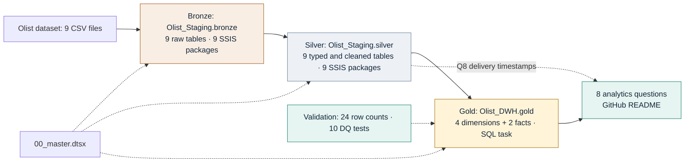
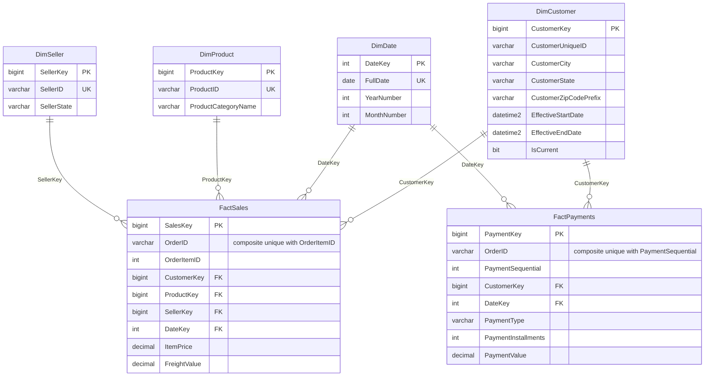
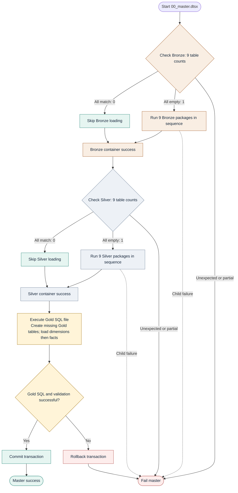

# BrightLearn | Olist Data Warehouse & SSIS Pipeline (2026)

**End-to-end Brazilian e-commerce data engineering project** built with Microsoft SQL Server 2025, SQL Server Management Studio (SSMS), Visual Studio 2022 and SQL Server Integration Services (SSIS).

The pipeline processes nine Brazilian Olist e-commerce source datasets through **Bronze → Silver → Gold**, then uses an analytics-ready dimensional model to answer business questions about sales, customers, sellers, payments and delivery performance.

> **Verified milestone:** `00_master.dtsx` completed successfully against the already-populated databases. A subsequent rerun also completed successfully, and all **24 table row counts were unchanged**. All **10 data-quality tests** passed. This verifies the current populated-dataset rerun behavior—not recovery after deleting rows/tables, or a full clean-server rebuild.

## Contents

- [Objectives and technology](#objectives-and-technology)
- [Architecture](#architecture)
- [Warehouse model](#warehouse-model)
- [SSIS orchestration and validation](#ssis-orchestration-and-validation)
- [Dataset and table counts](#dataset-and-table-counts)
- [Business analytics: eight questions and answers](#business-analytics--eight-questions-and-answers)
- [Repository guide and setup](#repository-guide-and-setup)
- [What has and has not been tested](#what-has-and-has-not-been-tested)
- [Project challenges and lessons](#project-challenges-and-lessons)

## Objectives and technology

**Business goal:** organize raw marketplace data into reliable tables that support clear analyses of ordering, item value, seller performance, payment choice and delivery timeliness.

**Engineering goals:** demonstrate CSV ingestion, SSIS workflow orchestration, Bronze/Silver/Gold separation, SQL transformations, dimensional modeling, data-quality testing, rerun safeguards, business analytics and documentation.

| Component | Implementation |
|---|---|
| Relational database | Microsoft SQL Server 2025 Developer Edition (T-SQL) |
| Database editor | SQL Server Management Studio (SSMS) |
| ETL/orchestration | Visual Studio 2022 + SSIS |
| Source | Brazilian Olist e-commerce dataset (9 CSV datasets) |
| Staging databases/schemas | `Olist_Staging.bronze` and `Olist_Staging.silver` |
| Analytics database/schema | `Olist_DWH.gold` |
| Orchestrator | `00_master.dtsx` |
| Documentation | Markdown, draw.io, Mermaid, validation SQL and execution evidence |

## Architecture

**Bronze:** raw source ingestion from the nine CSV datasets. **Silver:** cleaned and appropriately typed tables with one additional geolocation identifier column. **Gold:** four dimensions and two fact tables for analytics.



The project has **nine Bronze tables**, **nine Silver tables** and **six Gold tables** (24 in total). Silver order timestamps also support the delivery analysis, since no current Gold fact holds all delivered/estimated delivery timestamps.

## Warehouse model

Gold uses a dimensional model with four dimensions and two facts. FactSales has **one row per `(OrderID, OrderItemID)`**; FactPayments has **one row per `(OrderID, PaymentSequential)`**. They have different grains, so directly joining them by order ID could multiply monetary amounts.



`DimCustomer` contains **96,355 customer-location versions**, representing **96,096 underlying customer identifiers** and **259 additional historical versions** in the validated snapshot. Its SCD Type 2-like validity periods are derived from purchase-associated changes in recorded location—not verified dates when customers physically moved. General incremental SCD handling has not been independently tested.

## SSIS orchestration and validation

The master package coordinates Bronze, Silver, and Gold. Bronze and Silver each check all nine table counts before choosing whether to execute their loading chain; the Gold stage executes a combined SQL file for create-if-missing, insert-only loading and validation.



**Important limitation:** Bronze and Silver whole-layer checks support the existing static dataset when *all tables match expected row counts* or *all tables are empty*. They currently **stop on partial/unexpected counts**; they do not automatically repopulate a missing subset of rows. The checks also assume their target tables exist. Database creation scripts and the SSIS package have **not** been shown to recover deleted tables/rows end-to-end.

### Validated results

| Test or milestone | Recorded outcome |
|---|---|
| First `00_master.dtsx` execution on populated databases | **Success** |
| Second execution (rerun) on the same dataset | **Success** |
| Row counts after rerun | **24/24 PASS**; each difference from expected count = **0** |
| Formal data-quality suite | **10/10 PASS**; each `FailureCount = 0` |
| Customer, sales and payments relationship checks | Included in data-quality suite |
| Deleted-data restoration or fresh clean-server execution | **Not yet demonstrated** |

The quality suite checks valid/unique Silver customer and order identifiers, customer-to-order relationships, DimCustomer current/history rules, fact uniqueness and source coverage, fact dimension keys, and Silver-to-Gold monetary consistency. These are recorded results for this dataset rather than guarantees for future loads.

## Dataset and table counts

### Bronze and Silver (same validated row counts)

| Dataset / table suffix | Bronze rows | Silver rows |
|---|---:|---:|
| `olist_customers` | 99,441 | 99,441 |
| `olist_geolocation` | 1,000,163 | 1,000,163 |
| `olist_order_items` | 112,650 | 112,650 |
| `olist_order_payments` | 103,886 | 103,886 |
| `olist_order_reviews` | 99,224 | 99,224 |
| `olist_orders` | 99,441 | 99,441 |
| `olist_products` | 32,951 | 32,951 |
| `olist_sellers` | 3,095 | 3,095 |
| `product_category_translation` | 71 | 71 |

### Gold

| Table | Validated rows |
|---|---:|
| `gold.DimCustomer` | 96,355 |
| `gold.DimProduct` | 32,951 |
| `gold.DimSeller` | 3,095 |
| `gold.DimDate` | 774 |
| `gold.FactSales` | 112,650 |
| `gold.FactPayments` | 103,886 |

*Counts are from the recorded successful rerun validation of 17 November 2026. Source data is historical and is not a live feed.*

---

## Business Analytics — Eight Questions and Answers

These results were obtained by running `08_Business_Analytics_Queries.sql` in SQL Server Management Studio on 19 November 2026. Questions 1–7 use the Gold warehouse; Q8 uses Silver order data for delivery dates. Monetary values are in Brazilian reais (BRL). Item value is the sum of recorded item prices, excluding freight; it is not net revenue or profit. Order counts in the sales analysis refer to orders with recorded items, not necessarily delivered orders.

### Q01. What are the total sales value, order volume and average order value?

| Metric | Result |
|---|---:|
| Orders with items | 98,666 |
| Order items | 112,650 |
| Total item value (BRL) | 13,591,643.70 |
| Total freight (BRL) | 2,251,909.54 |
| Average order value excluding freight (BRL) | 137.75 |

**Insight:** The marketplace recorded more than BRL 13.59 million in item value. The average order value provides a baseline for evaluating basket-size and cross-selling initiatives.

### Q02. How does sales performance change month by month?

Monthly item value generally increased during 2017, rising from BRL 120,312.87 in January to a dataset peak of BRL 1,010,271.37 in November. November 2017 also recorded 7,451 orders with items, the highest monthly order count in the results. Sales remained comparatively strong during the first half of 2018.

| Purchase month | Orders with items | Item value (BRL) |
|---|---:|---:|
| January 2017 | 789 | 120,312.87 |
| October 2017 | 4,568 | 664,219.43 |
| November 2017 | 7,451 | 1,010,271.37 |
| December 2017 | 5,624 | 743,914.17 |
| January 2018 | 7,220 | 950,030.36 |
| March 2018 | 7,188 | 983,213.44 |
| April 2018 | 6,934 | 996,647.75 |
| May 2018 | 6,853 | 996,517.68 |
| August 2018 | 6,452 | 854,686.33 |

**Insight:** The November peak suggests a period worth investigating for promotional and seasonal demand planning. The query does not establish the cause of that peak. The selected months above summarize the trend; the SQL returns the full observed monthly series. Sparse months at the dataset boundaries should not be interpreted as normal full-month performance.

### Q03. Which ten product categories generate the highest sales value?

| Rank | Product category (source label) | Order items | Item value (BRL) |
|---:|---|---:|---:|
| 1 | beleza_saude | 9,670 | 1,258,681.34 |
| 2 | relogios_presentes | 5,991 | 1,205,005.68 |
| 3 | cama_mesa_banho | 11,115 | 1,036,988.68 |
| 4 | esporte_lazer | 8,641 | 988,048.97 |
| 5 | informatica_acess... | 7,827 | 911,954.32 |
| 6 | moveis_decoracao | 8,334 | 729,762.49 |
| 7 | cool_stuff | 3,796 | 635,290.85 |
| 8 | utilidades_domest... | 6,964 | 632,248.66 |
| 9 | automotivo | 4,235 | 592,720.11 |
| 10 | ferramentas_jardim | 4,347 | 485,256.46 |

*Two source labels are shortened as displayed in the SSMS screenshot.*

**Insight:** Health and beauty generated the highest item value, followed by watches and gifts. Bed, table and bath products recorded the largest number of items among these ten categories. The difference between item-value and volume rankings highlights the need to monitor both metrics when planning inventory and promotions.

### Q04. Which ten sellers generate the highest sales value?

| Rank | Seller ID | State | Orders with seller | Item value (BRL) |
|---:|---|---|---:|---:|
| 1 | `4869f7a5dfa277a7dca6462dcf3b52b2` | SP | 1,132 | 229,472.63 |
| 2 | `53243585a1d6dc2643021fd1853d8905` | BA | 358 | 222,776.05 |
| 3 | `4a3ca9315b744ce9f8e9374361493884` | SP | 1,806 | 200,472.92 |
| 4 | `fa1c13f2614d7b5c4749cbc52fecda94` | SP | 585 | 194,042.03 |
| 5 | `7c67e1448b00f6e969d365cea6b010ab` | SP | 982 | 187,923.89 |
| 6 | `7e93a43ef30c4f03f38b393420bc753a` | SP | 336 | 176,431.87 |
| 7 | `da8622b14eb17ae2831f4ac5b9dab84a` | SP | 1,314 | 160,236.57 |
| 8 | `7a67c85e85bb2ce8582c35f2203ad736` | SP | 1,160 | 141,745.53 |
| 9 | `1025f0e2d44d7041d6cf58b6550e0bfa` | SP | 915 | 138,968.55 |
| 10 | `955fee9216a65b617aa5c0531780ce60` | SP | 1,287 | 135,171.70 |

**Insight:** Nine of the ten highest-value sellers are located in São Paulo (SP). This concentration suggests opportunities to strengthen seller partnerships in that state while investigating seller development in other regions. These are item-value rankings, not seller profitability rankings.

### Q05. Which customer states generate the most orders?

| Rank | State | Distinct customers | Orders with items | Item value (BRL) |
|---:|---|---:|---:|---:|
| 1 | SP | 39,981 | 41,375 | 5,202,955.05 |
| 2 | RJ | 12,303 | 12,762 | 1,824,092.67 |
| 3 | MG | 11,178 | 11,544 | 1,585,308.03 |
| 4 | RS | 5,249 | 5,432 | 750,304.02 |
| 5 | PR | 4,840 | 4,998 | 683,083.76 |
| 6 | SC | 3,513 | 3,612 | 520,553.34 |
| 7 | BA | 3,257 | 3,358 | 511,349.99 |
| 8 | DF | 2,062 | 2,125 | 302,603.94 |
| 9 | ES | 1,956 | 2,025 | 275,037.31 |
| 10 | GO | 1,942 | 2,007 | 294,591.95 |

**Insight:** São Paulo leads demand, followed by Rio de Janeiro (RJ) and Minas Gerais (MG). These markets are useful starting points for regional marketing and fulfillment capacity planning.

### Q06. Which payment methods are most frequently used?

| Payment method | Payment records | Share of payment records | Orders using method | Payment value (BRL) |
|---|---:|---:|---:|---:|
| credit_card | 76,795 | 73.92% | 76,505 | 12,542,084.19 |
| boleto | 19,784 | 19.04% | 19,784 | 2,869,361.27 |
| voucher | 5,775 | 5.56% | 3,866 | 379,436.87 |
| debit_card | 1,529 | 1.47% | 1,528 | 217,989.79 |
| not_defined | 3 | 0.00% | 3 | 0.00 |

**Insight:** Credit card is the dominant payment method, with boleto (a Brazilian payment slip) a significant second choice. Maintaining reliable processing for both methods is important. Percentages refer to payment records, not unique orders; one order can use multiple methods. Percentages are rounded.

### Q07. What percentage of purchasing customers place repeat orders?

| Metric | Result |
|---|---:|
| Purchasing customers | 95,420 |
| Single-order customers | 92,507 |
| Repeat customers | 2,913 |
| Repeat customer rate | 3.05% |

**Insight:** Repeat purchasing is limited within the observed dataset. Loyalty campaigns, post-purchase engagement and customer retention analysis are potential opportunities. This rate measures repeat ordering within the observed period, not lifetime retention.

### Q08. What percentage of delivered orders arrive on time, and what is the average delivery time?

| Metric | Result |
|---|---:|
| Orders with delivered status | 96,478 |
| Eligible orders included | 96,470 |
| Excluded orders | 8 |
| On-time orders | 89,936 |
| Late orders | 6,534 |
| On-time delivery rate | 93.23% |
| Average delivery time (days) | 12.56 |

**Insight:** Most eligible delivered orders arrived on time, but 6,534 were late. Further analysis by seller, destination and shipment characteristics could help identify logistics improvement opportunities. The calculation excludes eight delivered-status orders that did not meet the query's eligibility criteria.

### Business recommendations

Prioritize high-demand regions and product categories, prepare operational capacity for peak demand, maintain reliable credit card and boleto payment processing, investigate repeat-purchase opportunities, and analyze the causes of late deliveries. These are recommendations based on descriptive historical results, not proven causal relationships.

---

## Repository guide and setup

The intended submission layout uses the existing GitHub repository's directory names:

```text
brightlearn_olist_dwh_2026/
├── .gitignore
├── README.md
├── Docs/
│   ├── Olist_Data_Dictionary.md
│   ├── Olist_Data_Lineage.md
│   └── Olist_Table_Metadata.csv
├── SQL/
│   ├── 00_Create_Databases.sql
│   ├── 01_Create_Bronze_Silver_Tables.sql
│   ├── 02_Create_Gold_Tables.sql
│   ├── Bronze/
│   ├── Silver/
│   ├── Gold/
│   └── Tests/
├── olist_data_warehouse_2026/
│   ├── olist_data_warehouse_2026.dtproj
│   ├── 00_master.dtsx
│   ├── Gold_All_Tables_SSIS_Ready.sql
│   └── ... other Bronze and Silver .dtsx packages ...
└── diagrams/                     # Extract architecture diagrams here before submission
    ├── 01_Medallion_Architecture.drawio
    ├── 01_Medallion_Architecture.png
    ├── 02_Gold_Dimensional_Model.drawio
    ├── 02_Gold_Dimensional_Model.png
    ├── 03_SSIS_Master_Workflow.drawio
    ├── 03_SSIS_Master_Workflow.png
    └── Mermaid_Diagrams.md
```

The directory tree is a **submission checklist / target structure**, not a claim that every listed file has already been confirmed in the GitHub copy. The editable draw.io diagrams and PNGs were prepared separately; extract the `diagrams/` folder from `Olist_Architecture_Diagrams.zip` into the repository before publishing so the paths resolve.

**Documentation:** [Data dictionary](Docs/Olist_Data_Dictionary.md) · [Data lineage](Docs/Olist_Data_Lineage.md)  
**SSIS:** [Master package](olist_data_warehouse_2026/00_master.dtsx) · [Gold SQL task script](olist_data_warehouse_2026/Gold_All_Tables_SSIS_Ready.sql)  
**Diagram references after extraction:** [Medallion](diagrams/01_Medallion_Architecture.png) · [Gold model](diagrams/02_Gold_Dimensional_Model.png) · [Master flow](diagrams/03_SSIS_Master_Workflow.png)

### Reproduction outline (not yet certified as a clean build)

1. Install SQL Server 2025, SSMS, Visual Studio 2022 and the SSIS Projects extension; obtain the nine original Olist CSV datasets separately.
2. In SSMS, review the creation scripts. The intended order is `00_Create_Databases.sql`, `01_Create_Bronze_Silver_Tables.sql`, and `02_Create_Gold_Tables.sql`. The schema scripts are designed for an **empty environment**, not for execution over the working populated databases.
3. Update the project connection managers and flat-file paths for the local machine. Verify that the Gold file connection points to the SQL script and that `00_master.dtsx` is the startup package.
4. Run the package only in an appropriately prepared environment, then execute the 24-table row-count validation, 10 data-quality tests, and eight analytics queries from the SQL scripts.

**Do not run these instructions directly on existing populated tables without reviewing their effects.** The project has demonstrated a successful populated-dataset rerun, but *not* an independently verified rebuild from an empty server. In particular, source paths, SQL Server connection names, database creation order and SSIS task assumptions need end-to-end testing. The public repository should not contain credentials, raw personal data or unneeded Visual Studio build artifacts.

## What has and has not been tested

| Scope | Evidence / status |
|---|---|
| Bronze, Silver and Gold populated for the current dataset | Verified row counts across all 24 tables |
| `00_master.dtsx` execution on populated databases | Verified successful execution |
| Repeat execution on those same populated databases | Verified success and unchanged counts |
| Formal SQL data quality on loaded records | 10 of 10 passed |
| Eight descriptive analytics questions | Queries executed and results documented above |
| Automated recovery of a deleted subset of rows | **Not demonstrated** |
| Automated recreation and repopulation of deleted tables | **Not demonstrated** |
| Complete rebuild on a separate empty SQL Server | **Not demonstrated** |
| General-purpose incremental/CDC handling | **Not demonstrated** |

## Project challenges and lessons

- **SSIS data types:** managed string-type and timestamp conversion issues, including Unicode/non-Unicode mismatches.
- **Validation discipline:** a green SSIS execution indicator does not by itself prove that rows reached their destination; row counts and data-quality checks are essential.
- **Duplicate protection:** identified a translation lookup table with **213 rows representing 71 distinct pairs repeated three times**; removed 142 duplicate rows after making a backup, then validated 71 remaining rows.
- **Master control flow:** added layer-level checks to avoid unnecessary reruns on a fully populated static dataset.
- **Debugging and recovery:** recovered Visual Studio project files after an application freeze and fixed missing Execute Package references and SQL task result bindings.
- **Honest scope reporting:** a verified rerun with unchanged row counts is not the same as recovery of deleted records or an independently proven clean rebuild.

## Further work

Potential extensions include end-to-end clean-environment testing, record-level incremental loading, robust late-arriving dimension handling, scheduling/monitoring, and dashboards. Those extensions are **not** presented as completed work here.

---

*BrightLearn Olist Data Engineering 2026 | SQL Server · SSIS · T-SQL · Bronze/Silver/Gold · Analytics*
