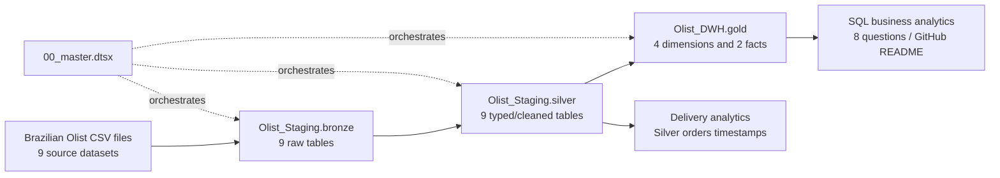

# Olist Data Warehouse — Data Lineage

**BrightLearn | Olist Data Engineering 2026**  
**Databases:** `Olist_Staging` (Bronze and Silver); `Olist_DWH` (Gold)  
**Orchestration:** Visual Studio 2022 / SSIS, `00_master.dtsx`  
**Companion documents:** `Olist_Data_Dictionary.md`, `Olist_Table_Metadata.csv`, and `diagrams/`.

## 1. Purpose and evidence

**Data lineage** shows where a field originated, which transformations and joins were applied, and where it is ultimately used. It helps an engineer troubleshoot inaccurate business reports, understand dependencies, and assess the impact of schema changes.

This document is grounded in the project's SQL Server metadata export, the six supplied Gold loading scripts (`DimCustomer_load.sql`, `DimProducts.sql`, `DimSeller.sql`, `DimDate.sql`, `FactSales.sql`, `FactPayments.sql`), the combined `Gold_All_Tables_SSIS_Ready.sql`, and recorded SSIS/validation outcomes. **The actual Bronze and Silver `.dtsx` package definitions were not provided for inspection**; therefore, their individual transformation components and error-handling expressions are not claimed as verified. Bronze-to-Silver type changes below are verified from actual database schemas, but the precise SSIS conversion expressions should be confirmed in the packages if deeper column-level lineage is required.

## 2. End-to-end flow

**Execution order:** Bronze → Silver → Gold. Bronze and Silver stages each begin with a whole-layer count check and conditionally skip their load chains when expected counts are present. Gold is loaded/validated with an Execute SQL Task using the combined SQL script. **These are static-dataset safeguards, not fully tested incremental/CDC handling.**

## 3. Source CSV → Bronze → Silver (nine datasets)

Source filenames below are **standard Olist dataset naming conventions**, not verified local paths. The corresponding 9 Bronze and 9 Silver table names and observed row counts come from the project.

| Standard Olist CSV source | Bronze destination | Silver destination | Recorded rows per layer | Observed Bronze → Silver schema differences |
|---|---|---|---:|---|
| `olist_customers_dataset.csv` | `bronze.olist_customers` | `silver.olist_customers` | 99,441 | All five columns remain `varchar`; customer identifiers and location attributes retained. |
| `olist_geolocation_dataset.csv` | `bronze.olist_geolocation` | `silver.olist_geolocation` | 1,000,163 | `geolocation_lat` and `geolocation_lng`: `varchar` → `decimal`; Silver adds a `bigint` `geolocation_id` column. |
| `olist_order_items_dataset.csv` | `bronze.olist_order_items` | `silver.olist_order_items` | 112,650 | `order_item_id`: `varchar` → `int`; `shipping_limit_date`: text → `datetime2`; `price`, `freight_value`: text → `decimal`. |
| `olist_order_payments_dataset.csv` | `bronze.olist_order_payments` | `silver.olist_order_payments` | 103,886 | `payment_sequential`, `payment_installments`: text → `int`; `payment_value`: text → `decimal`. |
| `olist_order_reviews_dataset.csv` | `bronze.olist_order_reviews` | `silver.olist_order_reviews` | 99,224 | `review_score`: `nvarchar` → `int`; review creation and answer timestamps: text → `datetime2`. |
| `olist_orders_dataset.csv` | `bronze.olist_orders` | `silver.olist_orders` | 99,441 | Identifier/status strings: `varchar` → `nvarchar`; five order lifecycle timestamps: text → `datetime2`. |
| `olist_products_dataset.csv` | `bronze.olist_products` | `silver.olist_products` | 32,951 | Product length, photo-count, weight and dimensions: text → `int`; source field spelling `lenght` is retained in Silver. |
| `olist_sellers_dataset.csv` | `bronze.olist_sellers` | `silver.olist_sellers` | 3,095 | Seller ID and location columns retained as `varchar`. |
| `product_category_name_translation.csv` | `bronze.product_category_translation` | `silver.product_category_translation` | 71 | Portuguese and English category fields retained as `nvarchar`. |

**Important:** The Bronze category translation table once contained 213 rows (three copies of each of 71 distinct pairs). The project removed 142 confirmed duplicates after backing up those original rows. The validated production snapshot is **71 rows**. Other Bronze data should be preserved as ingested.

## 4. Silver → Gold: target tables and dependencies

| Gold target (grain) | Direct or upstream source tables | Gold transformation / relationship | Validated rows |
|---|---|---|---:|
| `gold.DimCustomer` (one version per `CustomerUniqueID`, `EffectiveStartDate`) | `silver.olist_customers` **JOIN** `silver.olist_orders` by `customer_id` | SCD Type 2-like history from changes in city, state or ZIP observed along order purchase timestamps. `LAG`, running `SUM`, `LEAD`; generates `CustomerKey`; sets `IsCurrent`. | 96,355 |
| `gold.DimProduct` (one per `ProductID`) | `silver.olist_products` | Copies product category and physical/listing attributes; generates `ProductKey`; corrects `lenght` spelling in Gold field names. | 32,951 |
| `gold.DimSeller` (one per `SellerID`) | `silver.olist_sellers` | Copies seller address attributes and generates `SellerKey`. | 3,095 |
| `gold.DimDate` (one per calendar day) | MIN/MAX `silver.olist_orders.order_purchase_timestamp` | Builds a contiguous calendar with recursive CTE, creates numeric `DateKey` as YYYYMMDD and calendar attributes. | 774 |
| `gold.FactSales` (one per `(OrderID, OrderItemID)`) | `silver.olist_order_items` → `silver.olist_orders` → `silver.olist_customers`; plus all four Gold dimensions | Resolves customer history version using the purchase timestamp; joins Product, Seller and Date dimension keys. `ItemPrice = oi.price`; `FreightValue = oi.freight_value`. | 112,650 |
| `gold.FactPayments` (one per `(OrderID, PaymentSequential)`) | `silver.olist_order_payments` → `silver.olist_orders` → `silver.olist_customers`; plus Gold Customer and Date dimensions | Resolves customer history version by purchase timestamp and the order purchase `DateKey`; retains payment method, installment count, and value. | 103,886 |

**Not materialized into the present six Gold tables:** `silver.olist_geolocation`, `silver.olist_order_reviews`, and `silver.product_category_translation`. They remain available in Silver, and the category table can be used for translations in future analyses. The project’s delivery punctuality analytics also queries **Silver orders directly**, because no existing Gold fact contains delivered/estimated delivery timestamps.

### 4.1 Key field-level lineage — dimensions

| Gold target field(s) | Source / derivation |
|---|---|
| `DimCustomer.CustomerKey` | Generated SQL Server `IDENTITY` surrogate key. |
| `DimCustomer.CustomerUniqueID` | `silver.olist_customers.customer_unique_id`. |
| `DimCustomer.CustomerCity`, `CustomerState`, `CustomerZipCodePrefix` | Corresponding fields in `silver.olist_customers`; history groups are formed by observed changes. |
| `DimCustomer.EffectiveStartDate` | Earliest `silver.olist_orders.order_purchase_timestamp` for the identified location-version group. |
| `DimCustomer.EffectiveEndDate` | Next version start per customer via `LEAD`; null for latest version. |
| `DimCustomer.IsCurrent` | `1` when `EffectiveEndDate IS NULL`, else `0`. |
| `DimProduct.ProductKey` | Generated `IDENTITY` key. |
| `DimProduct.ProductID`, `ProductCategoryName` | `silver.olist_products.product_id`, `product_category_name`. |
| `DimProduct.ProductNameLength`, `ProductDescriptionLength` | `silver.olist_products.product_name_lenght`, `product_description_lenght` (corrected Gold names). |
| `DimProduct.ProductPhotosQty`, `ProductWeightG`, `ProductLengthCM`, `ProductHeightCM`, `ProductWidthCM` | Corresponding `silver.olist_products` columns (`product_photos_qty`, `product_weight_g`, `product_length_cm`, `product_height_cm`, `product_width_cm`). |
| `DimSeller.SellerKey` | Generated `IDENTITY` key. |
| `DimSeller.SellerID`, `SellerZipCodePrefix`, `SellerCity`, `SellerState` | Corresponding `silver.olist_sellers` fields. |
| `DimDate.FullDate` | Generated calendar from minimum to maximum non-null purchase date in `silver.olist_orders`. |
| `DimDate.DateKey` | `YEAR(FullDate)*10000 + MONTH(FullDate)*100 + DAY(FullDate)`. |
| `DimDate.YearNumber`, `QuarterNumber`, `MonthNumber`, `MonthName`, `DayOfMonth`, `DayName`, `IsWeekend` | Derived from `FullDate` with T-SQL date functions; weekend based on days since 1900-01-01. |
| Dimension `LoadDate` (where present) | SQL Server `SYSDATETIME()` default when Gold row inserted; not an Olist source timestamp. |

**Customer-history qualification:** These versions record **different locations observed in purchase-related customer records**; `EffectiveStartDate` does not prove when a person actually moved. The SQL is an initial snapshot load, not a tested general SCD incremental update procedure.

### 4.2 Key field-level lineage — facts

| Gold target field | Source / derivation |
|---|---|
| `FactSales.SalesKey` | Generated `IDENTITY` key. |
| `FactSales.OrderID`, `OrderItemID` | `silver.olist_order_items.order_id`, `order_item_id`. |
| `FactSales.CustomerKey` | `gold.DimCustomer.CustomerKey`, matched through `orders.customer_id → customers.customer_unique_id`, and `order_purchase_timestamp` in `[EffectiveStartDate, EffectiveEndDate)`. |
| `FactSales.ProductKey` | `gold.DimProduct.ProductKey`, joined on `order_items.product_id = DimProduct.ProductID`. |
| `FactSales.SellerKey` | `gold.DimSeller.SellerKey`, joined on `order_items.seller_id = DimSeller.SellerID`. |
| `FactSales.DateKey` | `gold.DimDate.DateKey` where `CAST(orders.order_purchase_timestamp AS date) = DimDate.FullDate`. |
| `FactSales.OrderPurchaseTimestamp` | `silver.olist_orders.order_purchase_timestamp`. |
| `FactSales.ItemPrice`, `FreightValue` | `silver.olist_order_items.price`, `freight_value`, in BRL. |
| `FactPayments.PaymentKey` | Generated `IDENTITY` key. |
| `FactPayments.OrderID`, `PaymentSequential` | `silver.olist_order_payments.order_id`, `payment_sequential`. |
| `FactPayments.CustomerKey` | `gold.DimCustomer.CustomerKey` using order customer and purchase-time history interval, as for FactSales. |
| `FactPayments.DateKey` | **Order purchase date**, via `orders.order_purchase_timestamp → DimDate.FullDate`; **not an independently captured payment date**. |
| `FactPayments.PaymentType`, `PaymentInstallments`, `PaymentValue` | `silver.olist_order_payments.payment_type`, `payment_installments`, `payment_value` (BRL). |
| Fact `LoadDate` | SQL Server `SYSDATETIME()` default on insertion. |

**Fact-grain warning:** `FactSales` and `FactPayments` have different grains and can have multiple rows per order. Joining them directly on `OrderID` can multiply measures. Aggregate to order level first or analyze separately.

## 5. Reporting / consumption lineage

| Business analysis | Main reporting source | Key metric or dependency |
|---|---|---|
| 01. Overall sales and average order value | `gold.FactSales` | Sum `ItemPrice`; distinct `OrderID`; item-price value per order. Not net revenue. |
| 02. Monthly sales trend | `gold.FactSales` / `gold.DimDate` | Sum item value grouped by purchase month. |
| 03. Top product categories | `gold.FactSales` + `gold.DimProduct` | Sum item value by `ProductCategoryName`. |
| 04. Top sellers | `gold.FactSales` + `gold.DimSeller` | Sum item value by seller. |
| 05. Orders by customer state | `gold.FactSales` + `gold.DimCustomer` | Count orders associated with customer location versions. |
| 06. Payment-method preference | `gold.FactPayments` | Count payment records by `PaymentType`; not necessarily number of unique orders. |
| 07. Repeat purchase behavior | `gold.FactSales` + `gold.DimCustomer` | Distinct orders associated with `CustomerUniqueID`. |
| 08. On-time delivery | `Olist_Staging.silver.olist_orders` | Compare delivered timestamp and estimated date, filter eligible orders. |

See `Business_Analytics_README_Section.md` for the recorded query outcomes and interpretations.

## 6. Load safeguards, data-quality checks, and observed status

- The `00_master.dtsx` project ran successfully and was successfully rerun against the already-populated static dataset.
- After the rerun, 24 of 24 Bronze/Silver/Gold table row-count checks matched the baseline; 10 of 10 supplied data-quality checks returned `PASS`.
- The Bronze translation deduplication retained 71 unique records after removal of 142 exact-repeat rows; a backup of the original 213 was created separately.
- Gold insertion scripts use `NOT EXISTS` against business-grain identifiers to avoid duplicate inserts on a repeated static-source load; FactSales and FactPayments include row-count validation and transactional handling. The combined Gold script contains a transaction and post-load checks.
- **Unverified:** clean-server rebuilding in script order, real-time/incremental change detection, handling partially loaded Bronze/Silver tables, and physical constraint enforcement in the deployed database (verify against `sys.key_constraints`, `sys.foreign_keys` if required).

## 7. Troubleshooting / change-impact map

| If this changes or fails… | Likely downstream areas affected |
|---|---|
| Customers CSV / Silver customer IDs or geography | `DimCustomer`, both Gold facts, repeat-customer and state reporting. |
| Orders CSV / purchase timestamps | `DimCustomer` version dates, `DimDate`, both Gold facts, sales trends, delivery analytics. |
| Order items CSV / price, product, seller | `FactSales`, sales totals, product/seller rankings. |
| Payment CSV / payment value or type | `FactPayments`, payment-method analysis. |
| Products or Sellers CSV | Their Gold dimensions and `FactSales` foreign-key resolution. |
| Reviews / Geolocation / Category translation CSV | Corresponding Bronze/Silver tables; no direct dependency in the six current Gold tables. |
| Gold dimension business keys or customer-history logic | Fact lookups and downstream joins/aggregation; validate fact counts and foreign keys. |

## 8. Reproducibility and limitations

The repository should contain the actual nine Bronze and nine Silver SSIS packages, `00_master.dtsx`, the Gold SQL script and/or component scripts, the schema-creation SQL, and verification queries. When reviewing this lineage, check the source/destination mappings in those `.dtsx` files for any detailed transformation behavior not evidenced by the metadata alone. The project currently uses file paths and fixed baseline counts associated with the Olist assignment dataset; path portability and an empty-environment rebuild remain separate verification tasks.

---

*Prepared for the BrightLearn Olist Data Engineering 2026 portfolio. This is a documentation artifact; it does not modify SQL Server data.*
